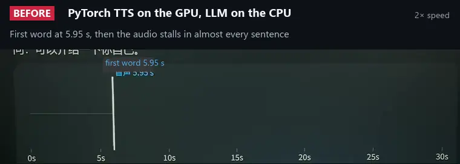
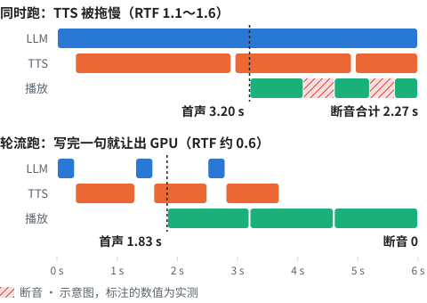

# gpu-duet

[中文](README.md) · English · [日本語](README.ja.md)

**Run a local LLM and a voice-cloning TTS on one 8 GB GPU: speech starts while the answer is still being generated, and long answers play with almost no gaps.**

*A local LLM and a zero-shot voice-cloning TTS take turns on one 8 GB GPU. Use them as local HTTP services, or as an offline voice server for ESP32 boards running xiaozhi firmware.*

[Results](#results) · [How it works](#how-it-works) · [Requirements](#requirements) · [Quick start](#quick-start) · [Connect a board](#connect-a-board-mode-b) · [Known limitations](#known-limitations) · [FAQ](#faq) · [Upstream fixes](#fixes-sent-upstream) · [Docs](#documentation) · [32 pitfalls](docs/pitfalls.en.md)

[](https://github.com/korexil/gpu-duet/actions/workflows/ci.yml)
[](https://github.com/korexil/gpu-duet/releases/latest)
[](LICENSE)
[](https://www.bilibili.com/video/BV15Cpr6eEMx)

| First audio | Total gaps | VRAM |
|:-:|:-:|:-:|
| 4.4&nbsp;→&nbsp;**2.3&nbsp;s** | 4.59&nbsp;→&nbsp;**0.09&nbsp;s** | **7.3&nbsp;GB**&nbsp;/&nbsp;8&nbsp;GB |

<a href="https://www.bilibili.com/video/BV15Cpr6eEMx"></a>

<sub>Live recording at 2× speed, same laptop and same question; red bars are where the audio stalled. Click for the full video (Bilibili, 3 min 28 s, in Chinese). The questions were asked live and their audio was later replaced with a synthesized voice; the board's answers are the live audio.</sub>

**Try it without a board:** Windows + an 8 GB NVIDIA GPU + a 3–10 s voice recording. Follow [Quick start](#quick-start) steps 1–5; the last step prints the total gap time.

## What it does

- **Two models on one 8 GB GPU**: Gemma 4 E4B (LLM) + Qwen3-TTS 1.7B (clones a voice from a 3–10 s recording), about 7.3 GB of VRAM in use on the whole card (about 6.8 GB for the two models, the rest is the desktop and other processes).
- **The LLM and the TTS take turns on the GPU**: a long answer of over a minute plays while it is being generated, and total gap time drops from 4.59 s to 0.09 s (the native engine and turn-taking together).
- **Per-sentence shaping**: after each sentence is synthesized, its loudness, pauses and peaks are evened out, so a small speaker doesn't jump between loud and quiet or clip.
- **Fully offline, on a single Windows PC**: use it as an ordinary local HTTP service, or as the server for xiaozhi ESP32 boards.

## Results

| | Before | After |
|---|---|---|
| Time to first audio on a long answer (from the question to the server sending its first audio frame; the board plays it later, by an amount not measured) | 4.4 s | **2.3 s** |
| Total gaps on a long answer (time playback was stalled) | 4.59 s, 48–60 stalls | **0.09 s** |
| Total VRAM (8 GB card) | about 8.3 GB, doesn't fit (native engine without the patches, estimated) | **about 7.3 GB** |

<sub>RTX 4060 Laptop 8 GB. First audio and gaps: the same long-answer question asked three times per setup and averaged, all setups measured in one sitting; questions sent as text, so first audio excludes VAD and ASR; gaps are estimated by the server against the device's 0.3 s prebuffer; "Before" is the PyTorch TTS + the LLM on the CPU. VRAM: "After" is a measured 7,448 MiB; "Before" is estimated by adding back the 488 + 594 MiB saved by the patches. GB follows Task Manager's convention (1 GB = 1024 MiB). In a controlled experiment that changed only the scheduling (6 runs per group, with a simulated 0.5 s-buffer player), 6/6 runs had gaps without turn-taking and 0/6 with it. Full data: [docs/benchmarks.en.md](docs/benchmarks.en.md).</sub>

## How it relates to xiaozhi

xiaozhi is an open-source ESP32 voice assistant in two parts: the [xiaozhi-esp32](https://github.com/78/xiaozhi-esp32) firmware on the board, and the [xiaozhi-esp32-server](https://github.com/xinnan-tech/xiaozhi-esp32-server) server on a PC.

**The core pieces of this repo (TTS engine, TTS service, GPU turn-taking, per-sentence shaping) don't depend on xiaozhi**; it only comes in when you connect a board. Three ways to use it:

| Mode | Good for | What to run | Needs xiaozhi? |
|---|---|---|---|
| **A. No board** | A local LLM + TTS for your own programs or another voice framework | `tts-service` + `llama-server` | No |
| **B. Standalone server** | You have a xiaozhi board but don't want Docker, a database or an admin console | A + `standalone/server.py` | Only the firmware on the board |
| **C. Plug into xiaozhi-esp32-server** | You want the admin console, multiple devices, speaker recognition, tool calling | A + the official Docker stack + the providers in [`server/`](server/) | Firmware + server |

Detailed comparison of the two board setups and each component's dependencies: [docs/architecture.md](docs/architecture.md).

## How it works

```
Microphone → VAD · ASR (CPU) → LLM (GPU) ⇄ take turns ⇄ TTS (GPU) → speaker
```


- **Saving VRAM**: the TTS runs on a patched native C++ engine, cutting its VRAM from about 5.0 → 4.0 GB and making room for the LLM.
- **Taking turns on the GPU**: when both run at once, the TTS slows down and synthesis can't keep up with playback. So the LLM pauses after every sentence it writes, and continues only once the TTS has finished synthesizing that sentence.
- **Per-sentence shaping**: after each sentence is synthesized, excess silence is trimmed, gain is normalized, peaks are limited and pauses are padded out.

<picture>
  <source media="(prefers-color-scheme: dark)" srcset="docs/img/timeline-dark.svg">
  
</picture>

Details and parameters: [docs/how-it-works.en.md](docs/how-it-works.en.md).

## Requirements

| | |
|---|---|
| GPU | NVIDIA, 8 GB VRAM (tested on RTX 4060 Laptop; the prebuilt engine supports RTX 20 / 30 / 40 / 50 series) |
| RAM | 16 GB |
| OS | Windows 10 / 11 x64 (tested on Windows 11; on Linux, CI only builds the CPU version of the C bridge and checks its ABI, and the CUDA engine and the full pipeline have never run there) |
| Disk | about 13 GB (model download about 8.8 GB) |
| Voice | A clean 3–10 s recording and its exact transcript ([how to prepare one](docs/voice-reference.md)) |
| Board (optional) | ESP32-S3 flashed with xiaozhi-esp32 firmware (tested on M5Stack Atom EchoS3R, Stack-chan) |

## Quick start

Run these in PowerShell from the repo root. You need Python 3.10+ and git (if you get "running scripts is disabled on this system", run `Set-ExecutionPolicy -Scope CurrentUser RemoteSigned` first). The examples use `..\gpu-duet-engine`, `..\models` and `..\llama.cpp` next to the repo; substitute your own directories.

**1. Download the engine and install dependencies.** Download the zip from [Releases](https://github.com/korexil/gpu-duet/releases/latest) and extract it to `..\gpu-duet-engine` (SHA256 in [native-tts/README.md](native-tts/README.md)). The CUDA runtime is installed with pip; no CUDA Toolkit needed:

```powershell
pip install -r tts-service\requirements.txt nvidia-cuda-runtime-cu12 nvidia-cublas-cu12
```

**2. Download the models.** The TTS is converted to F16 GGUF into `..\models\tts`, and the LLM goes into `..\models\llm`; `..\models\src` can be deleted after conversion.

```powershell
.\native-tts\setup-models.ps1 -Out ..\models -InstallDeps
```

**3. Extract the voice.** Put the recording in `my_voice.wav` and its exact transcript in `my_voice.txt` (UTF-8):

```powershell
python tts-service\extract_voice.py --library ..\gpu-duet-engine\qwen3_tts_bridge.dll `
    --models ..\models\tts --wav my_voice.wav --text my_voice.txt --out voice\icl-prompt.json
```

**4. Start the TTS first, then start the LLM in another window.** The order matters: otherwise the TTS may get pushed into shared memory and slow down. For `llama-server`, use the Windows CUDA build from [llama.cpp Releases](https://github.com/ggml-org/llama.cpp/releases).

```powershell
python tts-service\server.py --library ..\gpu-duet-engine\qwen3_tts_bridge.dll `
    --models ..\models\tts --icl-prompt voice\icl-prompt.json --language zh
```

```powershell
.\scripts\start-llm.ps1 -LlamaServer ..\llama.cpp\llama-server.exe `
    -Model ..\models\llm\gemma-4-E4B-it-q4_0-exact.gguf
```

**5. Try it without a board.** In the output, `underrun_total_s` is the total gap time; 0 means no stalls:

```powershell
python tools\turn_taking_sim.py --mode turns --question "说说你最喜欢的季节，讲长一点。"
```

At this point you have mode A: your own programs call `http://127.0.0.1:18766/stream` to synthesize speech. API reference: [tts-service/README.md](tts-service/README.md).

### Connect a board (mode B)

```powershell
pip install -r standalone\requirements.txt
python standalone\setup_models.py      # ASR, VAD and denoise models, about 240 MB
copy standalone\config.example.yaml standalone\config.yaml
python standalone\server.py
```

Set the board's OTA URL to the `http://<this-PC-IP>:8003/xiaozhi/ota/` printed in the startup log, and allow TCP 8000 and 8003 through the firewall. How to change the OTA URL, and how to test without a board: [standalone/README.md](standalone/README.md).

For mode C, see [server/README.md](server/README.md); to build the engine yourself, see [native-tts/README.md](native-tts/README.md).

## Known limitations

- Only tested on real hardware with an RTX 4060 Laptop + Windows 11. On Linux, CI only builds the CPU version of the C bridge and checks its ABI; the CUDA engine and the full pipeline have never run there. macOS is untested.
- `llamacpp_paced` doesn't support tool calling (MCP, device volume, etc.); the standalone server has no speaker recognition, memory or streaming ASR.
- Loudness between sentences is matched by setting each sentence's gain from its first 0.6 s only; this is not a loudness standard.
- By default the standalone server is only suitable for a trusted LAN (plaintext, token empty by default). Don't expose it directly to the internet; see [Security](standalone/README.md#安全).

Full list: [docs/architecture.md](docs/architecture.md#限制).

## FAQ

All numbers below were measured on an RTX 4060 Laptop (8 GB) with Windows 11.

### My local voice assistant stutters and long answers keep breaking up

When the LLM and the TTS share one GPU at the same time, the TTS slows down and synthesis falls behind playback. This repo makes them take turns on the GPU. On the same server pipeline, total gaps drop from 2.84 s to 0.09 s compared with running both at once (3-run averages, [four-stage measurements](docs/benchmarks.en.md)); in a controlled test that changes only the scheduling, 6 of 6 runs stalled at once and 0 of 6 when taking turns (simulated player, [pitfall #9](docs/pitfalls.en.md)). Throttling the LLM and changing the Windows GPU scheduling priority were tried and didn't help.

### It takes seconds after the question before it starts speaking

"Starts speaking" here is the server sending its first audio frame to the board; the board's own buffering and decoding come after that and aren't measured.

- Where the LLM runs and how it is scheduled (native TTS engine in all three): 5.3 s with the LLM on the CPU, 3.9 s with it on the GPU, 2.3 s when taking turns (3-run averages, [four-stage measurements](docs/benchmarks.en.md)).
- The GPU clocks down when idle: after 8 s idle, the TTS needs 0.64 s for its first block, against 0.17 s when warm (pitfall #11).
- The standalone server holds back 1.2 s of audio to trim each segment's trailing silence. When the first batch of audio is shorter than that, the first frame waits for the next block: 0.19 to 0.20 s longer when taking turns, 0.46 to 0.48 s when running at once ([PCM traces](bench/results/traces-2026-10-16/)).

### VRAM just fits, but everything gets slower with no error

What we ran into: with two TTS instances on the GPU, the Windows driver didn't report an error; it moved most of llama-server's VRAM to shared system memory, and decoding dropped from 66 to 45 tok/s. Check each process's "Dedicated GPU memory" in Task Manager and restart the affected process if it happens; normally start the TTS before the LLM (pitfall #12, [how it works](docs/how-it-works.en.md)).

### The LLM and the TTS don't fit on an 8 GB GPU

Without the patches it would take about 8.3 GB (estimated), more than the card has. Two patches to the TTS engine save about 1 GB: deduplicating the Q/K/V weights saves 488 MiB and keeping the text embedding table on the CPU saves 594 MiB. With them, the two models take about 6.8 GB and the whole card shows 7.3 GB in use, including the desktop. See [docs/how-it-works.en.md](docs/how-it-works.en.md).

### Loudness jumps between sentences, pauses vary, a small speaker clips

Each synthesized sentence is shaped the same way: one gain set from its first 0.6 s, leading silence trimmed, the trailing pause padded to a fixed length (0.9 s by default), and a smooth limiter keeping peaks at -6 dBFS (pitfalls #14 to #16).

### There is a "pop" every time before it speaks

The board we tested turns its amplifier off when idle and back on when it starts playing; other boards may not. After more than 1.5 s of silence, the first sentence starts with 0.3 s of silence (pitfall #17).

### The model won't open from a folder with non-ASCII characters

Upstream qwen3-tts.cpp opens the model and reference audio with ANSI `fopen`, so non-ASCII paths point at the wrong file. The engine patch here converts to wide characters first (`src/common/utf8_path.h`). Tested with Japanese folder names; Chinese ones weren't tested separately (pitfall #32).

### `WinError 206` when installing dependencies, or `Could not open output file ...cu.obj.d` when building

Both hit the 260-character path limit on Windows. For the dependencies, put the venv on a short path or enable long path support in Windows (pitfall #29); for the build, use a short build directory (pitfall #24).

## Fixes sent upstream

Problems found upstream while building this project, fixed and submitted as PRs (as of 2026-10-14):

| Upstream | PR | Summary | Status |
|---|---|---|---|
| [xiaozhi-esp32-server](https://github.com/xinnan-tech/xiaozhi-esp32-server) | [#3411](https://github.com/xinnan-tech/xiaozhi-esp32-server/pull/3411) | FunASR's raw JSON ended up in the chat history | Merged |
| | [#3413](https://github.com/xinnan-tech/xiaozhi-esp32-server/pull/3413) | TTS sentence splitting cut sentences inside quotation marks | Merged |
| | [#3412](https://github.com/xinnan-tech/xiaozhi-esp32-server/pull/3412) | SenseVoice Japanese transcripts had spaces between words | Merged |
| [qwen3-tts.cpp](https://github.com/Danmoreng/qwen3-tts.cpp) | [#5](https://github.com/Danmoreng/qwen3-tts.cpp/pull/5) | Open model, voice prompt and reference audio paths as UTF-8 (Chinese and Japanese directory names) | Awaiting response |
| | [#6](https://github.com/Danmoreng/qwen3-tts.cpp/pull/6) | Catch exceptions at the C boundary, export a struct ABI table, C bridge library | Awaiting response |

3 more branches are ready and will be submitted once #5 and #6 get a response: Q/K/V dedup (GPU −488 MiB), text embedding table on the CPU (GPU and RAM −594 MiB each), and decoding `\uXXXX` in the ICL prompt JSON. Details: [docs/upstream.md](docs/upstream.md).

## Documentation

The documents below are in Chinese.

| Document | Contents |
|---|---|
| [docs/how-it-works.en.md](docs/how-it-works.en.md) | How it works: VRAM-saving patches, GPU turn-taking timing and parameters, per-sentence shaping |
| [docs/benchmarks.en.md](docs/benchmarks.en.md) | Measured data and methodology |
| [docs/architecture.md](docs/architecture.md) | The three modes, component dependencies, ports and resources, runtime environment, limitations |
| [tts-service/README.md](tts-service/README.md) | TTS service launch options and HTTP API |
| [native-tts/README.md](native-tts/README.md) | Engine patch switches, prebuilt packages, building it yourself, models |
| [standalone/README.md](standalone/README.md) | Standalone server: connecting boards, configuration, live dashboard |
| [server/README.md](server/README.md) | Integrating with xiaozhi-esp32-server |
| [docs/voice-reference.md](docs/voice-reference.md) | How to prepare the reference audio |
| [docs/pitfalls.en.md](docs/pitfalls.en.md) | 32 pitfalls we ran into |
| [docs/standalone-tuning.md](docs/standalone-tuning.md) | Standalone server tuning notes |
| [docs/upstream.md](docs/upstream.md) | Upstream PRs and experimental branches |
| [docs/development.md](docs/development.md) | Directory layout, tests (no GPU or models needed), CI |
| [bench/README.md](bench/README.md) | Reproducing the benchmarks |

## Acknowledgements

[llama.cpp](https://github.com/ggml-org/llama.cpp), [qwen3-tts.cpp](https://github.com/Danmoreng/qwen3-tts.cpp), [Qwen3-TTS](https://github.com/QwenLM/Qwen3-TTS), [Gemma](https://ai.google.dev/gemma), [xiaozhi-esp32](https://github.com/78/xiaozhi-esp32), [xiaozhi-esp32-server](https://github.com/xinnan-tech/xiaozhi-esp32-server), [sherpa-onnx](https://github.com/k2-fsa/sherpa-onnx).

## License

[Apache-2.0](LICENSE); attributions in [NOTICE](NOTICE). When distributing or modifying, keep NOTICE and mark the files you changed. Upstream projects are under their own licenses: xiaozhi-esp32-server, qwen3-tts.cpp, ggml (MIT); Qwen3-TTS, Gemma 4 (Apache-2.0). This repo does not distribute models or the CUDA runtime. Get the person's consent before using someone else's voice as reference audio.
