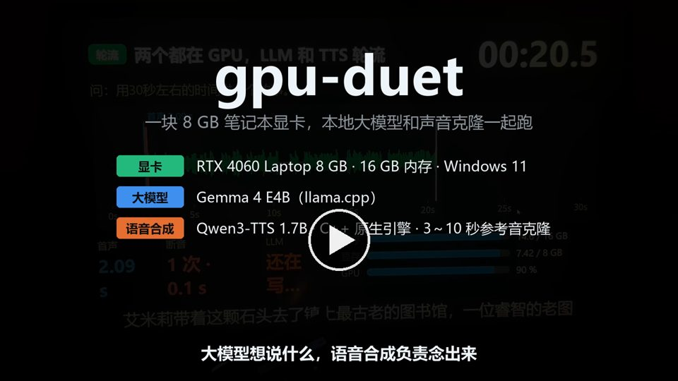

# gpu-duet

[中文](README.md) · [English](README.en.md) · 日本語

**ローカル LLM と音声クローン TTS で 8 GB の GPU を 1 枚共有。生成しながら話し始め、長い回答でもほとんど音切れしません。**

*ローカル LLM とゼロショット音声クローン TTS が、8 GB の GPU 1 枚を交代で使います。ローカル HTTP サービスとして使うことも、xiaozhi ファームウェアを載せた ESP32 ボード向けのオフライン音声サーバーとして使うこともできます。*

[](https://github.com/korexil/gpu-duet/actions/workflows/ci.yml)
[](https://github.com/korexil/gpu-duet/releases/latest)
[](LICENSE)
[](https://www.bilibili.com/video/BV15Cpr6eEMx)

<a href="https://www.bilibili.com/video/BV15Cpr6eEMx"></a>

<sub>実機での録画です。質問はその場でリアルタイムに話したもので、動画では質問の声だけ後から合成音声に差し替えています。ボードの回答はその場の音声そのままです。</sub>

## できること

- **8 GB の GPU 1 枚に 2 つのモデルを搭載**：Gemma 4 E4B（LLM）+ Qwen3-TTS 1.7B（3～10 秒の録音から声をクローン）。VRAM は合計約 7.3 GB。
- **LLM と TTS が GPU を交代で使用**：1 分を超える長い回答も生成しながら再生し、音切れの合計は 4.22 s から 0.17 s に減少。
- **文ごとの整音**：1 文合成するたびに音量・間・ピークをそろえるので、小さなスピーカーでも音量が上下したり音割れしたりしません。
- **完全オフライン、Windows PC 1 台で動作**：普通のローカル HTTP サービスとしても、xiaozhi の ESP32 ボード用サーバーとしてもそのまま使えます。

## 効果

| | 導入前 | 導入後 |
|---|---|---|
| 長い回答の第一声（質問し終えてから最初の音まで） | 6.2 s | **2.1 s** |
| 長い回答の音切れ合計（再生中に止まった時間） | 4.22 s、50 回以上途切れる | **0.17 s** |
| VRAM 合計（8 GB のカード） | 約 8.3 GB、収まらない（パッチなしのネイティブエンジン、推定） | **約 7.3 GB** |

<sub>RTX 4060 Laptop 8 GB。第一声・音切れ：同じ長文回答の質問をそれぞれ 2 回ずつ行った平均。「導入前」は PyTorch 版 TTS + CPU 上の LLM。VRAM：「導入後」は実測 7,448 MiB、「導入前」はパッチで削減した 488 + 594 MiB を足し戻した推算値。GB はタスクマネージャーの表記に合わせています（1 GB = 1024 MiB）。スケジューリングだけを変えた対照実験（各群 6 回）では、交代なしでは 6/6 回で音切れが発生し、交代ありでは 0/6 回でした。全データ：[docs/benchmarks.md](docs/benchmarks.md)。</sub>

## xiaozhi（小智）との関係

xiaozhi はオープンソースの ESP32 音声アシスタントで、ボード上の [xiaozhi-esp32](https://github.com/78/xiaozhi-esp32) ファームウェアと、PC 上の [xiaozhi-esp32-server](https://github.com/xinnan-tech/xiaozhi-esp32-server) サーバーの 2 つで構成されています。

**このリポジトリの中核部分（TTS エンジン、TTS サービス、GPU の交代利用、文ごとの整音）は xiaozhi に依存しません**。xiaozhi が必要になるのはボードをつなぐときだけです。使い方は 3 通りあります。

| 使い方 | 向いている用途 | 動かすもの | xiaozhi は必要？ |
|---|---|---|---|
| **A. ボードなし** | 自作プログラムや他の音声フレームワーク向けのローカル LLM + TTS | `tts-service` + `llama-server` | 不要 |
| **B. スタンドアロンサーバー** | xiaozhi ボードはあるが、Docker・データベース・管理画面は入れたくない | A + `standalone/server.py` | ボード上のファームウェアのみ |
| **C. xiaozhi-esp32-server に組み込む** | 管理画面、複数デバイス、話者認識、ツール呼び出しが必要 | A + 公式 Docker スタック + [`server/`](server/) の provider | ファームウェア + サーバー |

ボードをつなぐ 2 つの方法の詳しい比較と、各部品の依存関係：[docs/architecture.md](docs/architecture.md)。

## 仕組み

```
マイク → VAD · ASR（CPU） → LLM（GPU） ⇄ 交代 ⇄ TTS（GPU） → スピーカー
```


- **VRAM の節約**：TTS をパッチを当てた C++ ネイティブエンジンに置き換え、VRAM を約 5.0 → 4.0 GB に削減して LLM の場所を空けます。
- **GPU の交代利用**：両方を同時に動かすと TTS が遅くなり、合成が再生に追いつきません。そこで LLM は 1 文書き終えるごとに一時停止し、TTS がその文を合成し終えてから続きを書きます。
- **文ごとの整音**：1 文合成するたびに、余分な無音のカット、ゲインの統一、リミッター処理、間の補完を行います。

<picture>
  <source media="(prefers-color-scheme: dark)" srcset="docs/img/timeline-dark.svg">
  
</picture>

詳しい説明とパラメータ：[docs/how-it-works.md](docs/how-it-works.md)。

## 必要なもの

| | |
|---|---|
| GPU | NVIDIA、VRAM 8 GB（RTX 4060 Laptop で動作確認。ビルド済みエンジンは RTX 20 / 30 / 40 / 50 シリーズに対応） |
| メモリ | 16 GB |
| OS | Windows 10 / 11 x64（Windows 11 で動作確認。Linux は CI でビルドが通ることのみ確認） |
| ディスク | 約 13 GB（モデルのダウンロードは約 8.8 GB） |
| 声 | 3～10 秒のきれいな録音と、その書き起こし（一字一句そのまま）（[準備のしかた](docs/voice-reference.md)） |
| ボード（任意） | xiaozhi-esp32 ファームウェアを書き込んだ ESP32-S3（M5Stack Atom EchoS3R、Stack-chan で動作確認） |

## クイックスタート

リポジトリのルートで PowerShell から実行します。Python 3.10+ と git が必要です（「このシステムではスクリプトの実行が無効になっている」と表示される場合は、先に `Set-ExecutionPolicy -Scope CurrentUser RemoteSigned` を実行してください）。以下ではリポジトリの隣にある `..\gpu-duet-engine`、`..\models`、`..\llama.cpp` を例にしています。自分のディレクトリに置き換えてください。

**1. エンジンのダウンロードと依存関係のインストール。** [Releases](https://github.com/korexil/gpu-duet/releases/latest) から zip をダウンロードし、`..\gpu-duet-engine` に展開します（SHA256 は [native-tts/README.md](native-tts/README.md) を参照）。CUDA ランタイムは pip で入れるので、CUDA Toolkit のインストールは不要です。

```powershell
pip install -r tts-service\requirements.txt nvidia-cuda-runtime-cu12 nvidia-cublas-cu12
```

**2. モデルのダウンロード。** TTS は F16 GGUF に変換して `..\models\tts` に、LLM は `..\models\llm` に置かれます。変換後は `..\models\src` を削除してかまいません。

```powershell
.\native-tts\setup-models.ps1 -Out ..\models -InstallDeps
```

**3. 声の抽出。** 録音を `my_voice.wav` に、一字一句そのままの書き起こしを `my_voice.txt`（UTF-8）に保存します。

```powershell
python tts-service\extract_voice.py --library ..\gpu-duet-engine\qwen3_tts_bridge.dll `
    --models ..\models\tts --wav my_voice.wav --text my_voice.txt --out voice\icl-prompt.json
```

**4. 先に TTS を起動し、別のウィンドウで LLM を起動。** 順番を逆にすると、TTS が共有メモリに追い出されて遅くなることがあります。`llama-server` は [llama.cpp Releases](https://github.com/ggml-org/llama.cpp/releases) の Windows CUDA 版を使います。

```powershell
python tts-service\server.py --library ..\gpu-duet-engine\qwen3_tts_bridge.dll `
    --models ..\models\tts --icl-prompt voice\icl-prompt.json --language zh
```

```powershell
.\scripts\start-llm.ps1 -LlamaServer ..\llama.cpp\llama-server.exe `
    -Model ..\models\llm\gemma-4-E4B-it-q4_0-exact.gguf
```

**5. ボードなしで試す。** 出力の `underrun_total_s` が音切れの合計で、0 なら途切れていません。

```powershell
python tools\turn_taking_sim.py --mode turns --question "说说你最喜欢的季节，讲长一点。"
```

ここまでで使い方 A の状態です。自作プログラムから `http://127.0.0.1:18766/stream` を呼べば音声を合成できます。API は [tts-service/README.md](tts-service/README.md) を参照してください。

**6. ボードをつなぐ（使い方 B）。**

```powershell
pip install -r standalone\requirements.txt
python standalone\setup_models.py      # ASR・VAD・ノイズ除去モデル、約 240 MB
copy standalone\config.example.yaml standalone\config.yaml
python standalone\server.py
```

ボードの OTA アドレスを、起動ログに表示される `http://<このPCのIP>:8003/xiaozhi/ota/` に変更し、ファイアウォールで TCP 8000 と 8003 を許可します。OTA アドレスの変更方法と、ボードがない場合のテスト方法は [standalone/README.md](standalone/README.md) にあります。

使い方 C は [server/README.md](server/README.md)、エンジンを自分でビルドする場合は [native-tts/README.md](native-tts/README.md) を参照してください。

## 既知の制限

- 実機で試したのは RTX 4060 Laptop + Windows 11 のみです。Linux は CI でビルドが通ることのみ確認しており、macOS は未検証です。
- `llamacpp_paced` はツール呼び出し（MCP、デバイスの音量調整など）に対応していません。スタンドアロンサーバーには話者認識、記憶、ストリーミング ASR がありません。
- 文と文の間の音量は、各文の冒頭 0.6 s だけをもとにゲインを決めています。ラウドネス規格に準拠したものではありません。
- スタンドアロンサーバーのデフォルト設定は、信頼できる LAN 内での利用のみを想定しています（平文通信、token はデフォルトで空）。インターネットに直接公開しないでください。[セキュリティ](standalone/README.md#安全)を参照。

全一覧：[docs/architecture.md](docs/architecture.md#限制)。

## 上流への修正

このプロジェクトの開発中に上流で見つけた問題を修正し、PR を送りました（2026-10-14 時点）。

| 上流 | PR | 内容 | 状態 |
|---|---|---|---|
| [xiaozhi-esp32-server](https://github.com/xinnan-tech/xiaozhi-esp32-server) | [#3411](https://github.com/xinnan-tech/xiaozhi-esp32-server/pull/3411) | FunASR の JSON がそのまま会話履歴に入る | マージ済み |
| | [#3413](https://github.com/xinnan-tech/xiaozhi-esp32-server/pull/3413) | TTS の文分割が引用符の内側で文を切ってしまう | マージ済み |
| | [#3412](https://github.com/xinnan-tech/xiaozhi-esp32-server/pull/3412) | SenseVoice の日本語認識結果に単語ごとの空白が入る | マージ済み |
| [qwen3-tts.cpp](https://github.com/Danmoreng/qwen3-tts.cpp) | [#5](https://github.com/Danmoreng/qwen3-tts.cpp/pull/5) | モデル、ボイスプロンプト、参照音声のパスを UTF-8 で開く（中国語・日本語のディレクトリ名） | 返信待ち |
| | [#6](https://github.com/Danmoreng/qwen3-tts.cpp/pull/6) | C 境界での例外捕捉、構造体 ABI テーブルのエクスポート、C ブリッジライブラリ | 返信待ち |

ほかに 3 つのブランチを用意してあり、#5・#6 に反応があり次第提出します：Q/K/V の重複排除（GPU −488 MiB）、テキスト埋め込みテーブルの CPU 配置（GPU・メモリそれぞれ −594 MiB）、ICL プロンプト JSON の `\uXXXX` デコード。詳細：[docs/upstream.md](docs/upstream.md)。

## ドキュメント

以下のドキュメントは中国語です。

| ドキュメント | 内容 |
|---|---|
| [docs/how-it-works.md](docs/how-it-works.md) | 仕組み：VRAM 節約パッチ、GPU 交代利用のタイミングとパラメータ、文ごとの整音 |
| [docs/benchmarks.md](docs/benchmarks.md) | 実測データと測定方法 |
| [docs/architecture.md](docs/architecture.md) | 3 つの使い方、部品の依存関係、ポートとリソース、動作環境、制限 |
| [tts-service/README.md](tts-service/README.md) | TTS サービスの起動オプションと HTTP API |
| [native-tts/README.md](native-tts/README.md) | エンジンパッチのスイッチ、ビルド済みパッケージ、自前ビルド、モデル |
| [standalone/README.md](standalone/README.md) | スタンドアロンサーバー：ボードの接続、設定、リアルタイムダッシュボード |
| [server/README.md](server/README.md) | xiaozhi-esp32-server への組み込み |
| [docs/voice-reference.md](docs/voice-reference.md) | 参照音声の準備のしかた |
| [docs/pitfalls.md](docs/pitfalls.md) | ハマりどころ 32 項目 |
| [docs/standalone-tuning.md](docs/standalone-tuning.md) | スタンドアロンサーバーの調整記録 |
| [docs/upstream.md](docs/upstream.md) | 上流に送った PR、実験ブランチ |
| [docs/development.md](docs/development.md) | ディレクトリ構成、テスト（GPU・モデル不要）、CI |
| [bench/README.md](bench/README.md) | benchmark の再現 |

## 謝辞

[llama.cpp](https://github.com/ggml-org/llama.cpp)、[qwen3-tts.cpp](https://github.com/Danmoreng/qwen3-tts.cpp)、[Qwen3-TTS](https://github.com/QwenLM/Qwen3-TTS)、[Gemma](https://ai.google.dev/gemma)、[xiaozhi-esp32](https://github.com/78/xiaozhi-esp32)、[xiaozhi-esp32-server](https://github.com/xinnan-tech/xiaozhi-esp32-server)、[sherpa-onnx](https://github.com/k2-fsa/sherpa-onnx)。

## ライセンス

[Apache-2.0](LICENSE)。帰属表示は [NOTICE](NOTICE) にあります。配布・改変する際は NOTICE を残し、変更したファイルにはその旨を明記してください。上流はそれぞれ独自のライセンスに従います。xiaozhi-esp32-server・qwen3-tts.cpp・ggml は MIT、Qwen3-TTS・Gemma 4 は Apache-2.0 です。このリポジトリはモデルと CUDA ランタイムを配布していません。他人の声を参照音声に使う場合は、事前に本人の同意を得てください。
