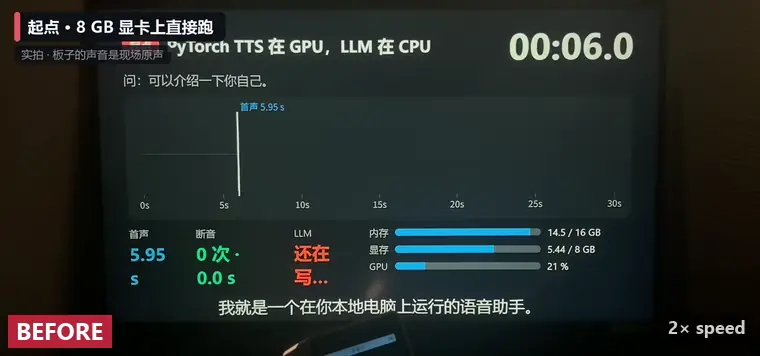

# gpu-duet

中文 · [English](README.en.md) · [日本語](README.ja.md)

**让本地 LLM 和声音克隆 TTS 共用一块 8 GB 显卡：边生成边说话，长回答几乎不断音。**

*A local LLM and a zero-shot voice-cloning TTS take turns on one 8 GB GPU. Use them as local HTTP services, or as an offline voice server for ESP32 boards running xiaozhi firmware.*

[效果](#效果) · [原理](#原理) · [需要什么](#需要什么) · [快速开始](#快速开始) · [接板子](#接板子用法-b) · [已知限制](#已知限制) · [常见问题](#常见问题) · [上游修复](#提给上游的修复) · [文档](#文档) · [32 条踩坑](docs/pitfalls.md)

[](https://github.com/korexil/gpu-duet/actions/workflows/ci.yml)
[](https://github.com/korexil/gpu-duet/releases/latest)
[](LICENSE)
[](https://www.bilibili.com/video/BV15Cpr6eEMx)

| 首声 | 断音合计 | 显存 |
|:-:|:-:|:-:|
| 4.4&nbsp;→&nbsp;**2.3&nbsp;s** | 4.59&nbsp;→&nbsp;**0.09&nbsp;s** | **7.3&nbsp;GB**&nbsp;/&nbsp;8&nbsp;GB |

<a href="https://www.bilibili.com/video/BV15Cpr6eEMx"></a>

<sub>实机录像，2 倍速，红色竖条是声音断掉的地方。点图看完整视频（B 站 3 分 28 秒）：提问是现场实时问的，视频里的提问声后来换成了合成声；板子的回答是现场原声。</sub>

**不接板子先试一下：** Windows + NVIDIA 8 GB 显卡 + 一段 3～10 秒的录音，按[快速开始](#快速开始)第 1～5 步走，最后一步直接打印断音合计。

## 能做什么

- **一块 8 GB 显卡装下两个模型**：Gemma 4 E4B（LLM）+ Qwen3-TTS 1.7B（用 3～10 秒录音克隆声音），整卡显存占用约 7.3 GB（两个模型约 6.8 GB，其余是桌面等）。
- **LLM 和 TTS 轮流用 GPU**：一分多钟的长回答边生成边播放，断音合计从 4.59 s 降到 0.09 s（整套改动：换原生引擎 + 轮流）。
- **逐句整形**：每句合成后统一响度、停顿和峰值，小喇叭上不忽大忽小、不爆音。
- **全部离线，跑在一台 Windows 电脑上**：可以当普通的本地 HTTP 服务用，也可以直接给 ESP32 小智板子当服务端。

## 效果

| | 之前 | 之后 |
|---|---|---|
| 长回答首声（发出问题到服务端发出第一帧音频；板子出声还要再晚，晚多少没测） | 4.4 s | **2.3 s** |
| 长回答断音合计（播放中卡住的时长） | 4.59 s，卡 48～60 次 | **0.09 s** |
| 显存合计（8 GB 卡） | 约 8.3 GB，装不下（未打补丁的原生引擎，推算） | **约 7.3 GB** |

<sub>RTX 4060 Laptop 8 GB。首声、断音：同一个长回答问题各问三次取平均（四个阶段在同一时段测完），文字提问（首声不含 VAD 和 ASR），断音由服务端按设备 0.3 s 预缓冲估算，「之前」是 PyTorch 版 TTS + CPU 上的 LLM。显存：「之后」是实测 7,448 MiB，「之前」是再加上补丁省下的 488 + 594 MiB 推算出来的；GB 按任务管理器的口径（1 GB = 1024 MiB）。只改调度的对照实验（每组 6 次，模拟 0.5 s 缓冲的播放器）里，轮流前 6/6 次有断音，轮流后 0/6。全部数据：[docs/benchmarks.md](docs/benchmarks.md)。</sub>

v0.1.3（2026-10-18）去掉了服务端的尾部扣留：轮流时第一帧随第一块音频一起发出（三次 1.77～1.96 s，之前要再等 0.19 s），开头偶发的 0.13 s 断音消失（三次全 0）；同一问题经新旧服务端各放一遍，段间停顿和首尾静音的统计相同，盲听也听不出区别（1 个问题、1 对有效对比、1 人）。见 [docs/benchmarks.md](docs/benchmarks.md#v013去掉尾部扣留之后2026-10-18)。

## 和小智（xiaozhi）的关系

小智是一个开源的 ESP32 语音助手，分两部分：板子上的 [xiaozhi-esp32](https://github.com/78/xiaozhi-esp32) 固件，和电脑上的 [xiaozhi-esp32-server](https://github.com/xinnan-tech/xiaozhi-esp32-server) 服务端。

**本仓库的核心部件（TTS 引擎、TTS 服务、GPU 轮流、逐句整形）都不依赖小智**，只有接板子时才用到它。三种用法：

| 用法 | 适合 | 要跑的 | 要不要小智 |
|---|---|---|---|
| **A. 不接板子** | 给自己的程序、别的语音框架当本地 LLM + TTS | `tts-service` + `llama-server` | 不要 |
| **B. 独立服务端** | 有小智板子，不想装 Docker、数据库、管理后台 | A + `standalone/server.py` | 只要板子上的固件 |
| **C. 挂进 xiaozhi-esp32-server** | 要管理后台、多设备、声纹、工具调用 | A + 官方 Docker 栈 + [`server/`](server/) 里的 provider | 固件 + 服务端 |

两种接板子方式的详细对比、各部件的依赖：[docs/architecture.md](docs/architecture.md)。

## 原理

```
麦克风 → VAD · ASR（CPU） → LLM（GPU） ⇄ 轮流 ⇄ TTS（GPU） → 喇叭
```

- **省显存**：TTS 换成打了补丁的 C++ 原生引擎，显存约 5.0 → 4.0 GB，给 LLM 腾出位置。
- **轮流用 GPU**：两者同时跑时 TTS 被拖慢，合成赶不上播放。所以 LLM 每写完一句就暂停，等 TTS 合成完这句再接着写。
- **逐句整形**：每句合成后切掉多余静音、统一增益、限幅、补齐停顿。

<picture>
  <source media="(prefers-color-scheme: dark)" srcset="docs/img/timeline-dark.svg">
  
</picture>

详细说明和参数：[docs/how-it-works.md](docs/how-it-works.md)。

## 需要什么

| | |
|---|---|
| 显卡 | NVIDIA，8 GB 显存（实测 RTX 4060 Laptop；预编译引擎支持 RTX 20 / 30 / 40 / 50 系） |
| 内存 | 16 GB |
| 系统 | Windows 10 / 11 x64（实测 Windows 11；Linux 上 CI 只编译 CPU 版 C 桥接库并核对 ABI，CUDA 引擎和整条管线没在 Linux 上跑过） |
| 磁盘 | 约 13 GB（模型下载约 8.8 GB） |
| 声音 | 一段 3～10 秒的干净录音和它的逐字文本（[怎么准备](docs/voice-reference.md)） |
| 板子（可选） | ESP32-S3，刷 xiaozhi-esp32 固件（实测 M5Stack Atom EchoS3R、Stack-chan） |

## 快速开始

在本仓库根目录的 PowerShell 里执行，需要 Python 3.10+ 和 git（提示「禁止运行脚本」时先 `Set-ExecutionPolicy -Scope CurrentUser RemoteSigned`）。下面用仓库旁边的 `..\gpu-duet-engine`、`..\models`、`..\llama.cpp` 当例子，换成你自己的目录即可。

**1. 下载引擎、装依赖。** 从 [Releases](https://github.com/korexil/gpu-duet/releases/latest) 下载 zip，解压到 `..\gpu-duet-engine`（SHA256 见 [native-tts/README.md](native-tts/README.md)）。CUDA 运行库用 pip 装，不用装 CUDA Toolkit：

```powershell
pip install -r tts-service\requirements.txt nvidia-cuda-runtime-cu12 nvidia-cublas-cu12
```

**2. 下载模型。** TTS 转成 F16 GGUF 放到 `..\models\tts`，LLM 放到 `..\models\llm`；转换完可删 `..\models\src`。

```powershell
.\native-tts\setup-models.ps1 -Out ..\models -InstallDeps
```

**3. 提取声音。** 录音 `my_voice.wav`，逐字文本写进 `my_voice.txt`（UTF-8）：

```powershell
python tts-service\extract_voice.py --library ..\gpu-duet-engine\qwen3_tts_bridge.dll `
    --models ..\models\tts --wav my_voice.wav --text my_voice.txt --out voice\icl-prompt.json
```

**4. 先启动 TTS，再另开窗口启动 LLM。** 顺序不能反，否则 TTS 可能被挤到共享内存、变慢。`llama-server` 用 [llama.cpp Releases](https://github.com/ggml-org/llama.cpp/releases) 的 Windows CUDA 版。

```powershell
python tts-service\server.py --library ..\gpu-duet-engine\qwen3_tts_bridge.dll `
    --models ..\models\tts --icl-prompt voice\icl-prompt.json --language zh
```

```powershell
.\scripts\start-llm.ps1 -LlamaServer ..\llama.cpp\llama-server.exe `
    -Model ..\models\llm\gemma-4-E4B-it-q4_0-exact.gguf
```

**5. 不接板子试一下。** 输出里 `underrun_total_s` 是断音合计，0 就是没卡：

```powershell
python tools\turn_taking_sim.py --mode turns --question "说说你最喜欢的季节，讲长一点。"
```

到这一步就是用法 A：自己的程序调 `http://127.0.0.1:18766/stream` 合成语音，接口见 [tts-service/README.md](tts-service/README.md)。

### 接板子（用法 B）

```powershell
pip install -r standalone\requirements.txt
python standalone\setup_models.py      # ASR、VAD、降噪模型，约 240 MB
copy standalone\config.example.yaml standalone\config.yaml
python standalone\server.py
```

把板子的 OTA 地址改成启动日志打出的 `http://<本机IP>:8003/xiaozhi/ota/`，防火墙放行 TCP 8000、8003。改 OTA 地址的办法、没有板子时的测试方法见 [standalone/README.md](standalone/README.md)。

用法 C 见 [server/README.md](server/README.md)；自己编译引擎见 [native-tts/README.md](native-tts/README.md)。

## 已知限制

- 实机只测过 RTX 4060 Laptop + Windows 11。Linux 上 CI 只编译 CPU 版 C 桥接库并核对 ABI，CUDA 引擎和整条管线没在 Linux 上跑过；macOS 没测过。
- `llamacpp_paced` 不支持工具调用（MCP、设备音量等）；独立服务端没有声纹、记忆和流式 ASR。
- 句间响度只按每句开头 0.6 s 定增益，不是响度标准。
- 独立服务端默认只适合受信任的局域网（明文、token 默认为空），不要直接暴露到公网，见[安全](standalone/README.md#安全)。

完整列表：[docs/architecture.md](docs/architecture.md#限制)。

## 常见问题

以下数字都是在 RTX 4060 Laptop（8 GB）+ Windows 11 上测的。

### 本地语音助手说话一顿一顿，长回答断断续续

LLM 和 TTS 同时用一块显卡时，TTS 被拖慢，合成赶不上播放。本仓库让两者轮流用 GPU。同一条服务端管线上，和同时跑相比，断音合计从 2.84 s 降到 0.09 s（各三次平均，[四阶段实测](docs/benchmarks.md)）；只改调度的对照实验里，同时跑 6/6 次断音，轮流 0/6（模拟播放器，[踩坑 #9](docs/pitfalls.md)）。给 LLM 限速、调 Windows 的 GPU 调度优先级都试过，没有用。

### 问完之后要等好几秒才开口

这里的「开口」是服务端向板子发出第一帧音频的时刻；板子自己的缓冲和解码还在后面，没有测。

- LLM 的位置和调度（TTS 都用原生引擎）：LLM 在 CPU 上时是 5.3 s，换到 GPU 是 3.9 s，再改成轮流是 2.3 s（各三次平均，[四阶段实测](docs/benchmarks.md)）。
- GPU 空闲后会降频：空闲 8 s 后，TTS 第一块音频要 0.64 s，热态 0.17 s（踩坑 #11）。
- 独立服务端为了修剪段尾静音，会先扣住 1.2 s 音频。第一批音频不到 1.2 s 时，要等下一块到了才发第一帧：轮流时多等 0.19～0.20 s，同时跑时 0.46～0.48 s（[PCM 跟踪](bench/results/traces-2026-10-16/)）。

### 显存刚好够，却越跑越慢，也不报错

我们遇到过：两个 TTS 实例同时占着显卡时，Windows 驱动没有报错，而是把 llama-server 的大部分显存挪到共享内存，解码从 66 降到 45 tok/s。在任务管理器里看每个进程的「专用 GPU 内存」，出现时重启受影响的进程；平时先启动 TTS 再启动 LLM（踩坑 #12，[原理](docs/how-it-works.md)）。

### 8 GB 显卡装不下 LLM 和 TTS

不打补丁，推算要 8.3 GB 左右，超出 8 GB。TTS 引擎的两个补丁省约 1 GB：Q/K/V 权重去重省 488 MiB，文本嵌入表放 CPU 省 594 MiB。打补丁后两个模型合计约 6.8 GB，整卡占用 7.3 GB（含桌面）。见 [docs/how-it-works.md](docs/how-it-works.md)。

### 一段回答里忽大忽小、停顿忽长忽短、小喇叭爆音

逐句合成后统一整形：每句按开头 0.6 s 定一个增益，切掉开头静音，句尾停顿补到固定长度（默认 0.9 s），用平滑限幅把峰值留在 -6 dBFS（踩坑 #14～#16）。

### 每次开口前「啪」一声

我们测的板子空闲时会关功放，开口时才上电，其他板子不一定这样。静默 1.5 s 以上之后的第一句，前面留 0.3 s 静音（踩坑 #17）。

### 中文或日文目录下打不开模型

上游 qwen3-tts.cpp 用 ANSI `fopen` 打开模型和参考音，非 ASCII 路径会找错文件。本仓库的引擎补丁改成先转宽字符再打开（`src/common/utf8_path.h`）。已用日文目录实测，中文目录没有单独测（踩坑 #32）。

### 装依赖报 `WinError 206`，或编译报 `Could not open output file ...cu.obj.d`

都是撞上了 Windows 260 字符的路径长度限制。装依赖时，把 venv 放在短路径下，或在系统里开启长路径支持（踩坑 #29）；编译时，把编译目录放在短路径下（踩坑 #24）。

## 提给上游的修复

做这个项目时在上游发现的问题，修好后提了 PR（截至 2026-10-14）：

| 上游 | PR | 内容 | 状态 |
|---|---|---|---|
| [xiaozhi-esp32-server](https://github.com/xinnan-tech/xiaozhi-esp32-server) | [#3411](https://github.com/xinnan-tech/xiaozhi-esp32-server/pull/3411) | FunASR 的 JSON 原样进入对话历史 | 已合并 |
| | [#3413](https://github.com/xinnan-tech/xiaozhi-esp32-server/pull/3413) | TTS 分句在引号内切开句子 | 已合并 |
| | [#3412](https://github.com/xinnan-tech/xiaozhi-esp32-server/pull/3412) | SenseVoice 日语识别结果按词带空格 | 已合并 |
| [qwen3-tts.cpp](https://github.com/Danmoreng/qwen3-tts.cpp) | [#5](https://github.com/Danmoreng/qwen3-tts.cpp/pull/5) | 模型、声音提示、参考音路径按 UTF-8 打开（中文、日文目录） | 待回复 |
| | [#6](https://github.com/Danmoreng/qwen3-tts.cpp/pull/6) | C 边界捕获异常、导出结构体 ABI 表、C 桥接库 | 待回复 |

另有 3 个分支已备好，等 #5、#6 有回应再提：Q/K/V 去重（GPU −488 MiB）、文本表放 CPU（GPU、内存各 −594 MiB）、ICL 提示 JSON 的 `\uXXXX` 解码。详情：[docs/upstream.md](docs/upstream.md)。

## 文档

| 文档 | 内容 |
|---|---|
| [docs/how-it-works.md](docs/how-it-works.md) | 原理：省显存补丁、GPU 轮流的时序和参数、逐句整形 |
| [docs/benchmarks.md](docs/benchmarks.md) | 实测数据和测量方法 |
| [docs/architecture.md](docs/architecture.md) | 三种用法、部件依赖、端口和资源、运行环境、限制 |
| [tts-service/README.md](tts-service/README.md) | TTS 服务的启动参数和 HTTP 接口 |
| [native-tts/README.md](native-tts/README.md) | 引擎补丁开关、预编译包、自己编译、模型 |
| [standalone/README.md](standalone/README.md) | 独立服务端：连板子、配置、实时面板 |
| [server/README.md](server/README.md) | 接入 xiaozhi-esp32-server |
| [docs/voice-reference.md](docs/voice-reference.md) | 怎么准备参考音 |
| [docs/pitfalls.md](docs/pitfalls.md) | 踩坑 32 条 |
| [docs/standalone-tuning.md](docs/standalone-tuning.md) | 独立服务端的调试记录 |
| [docs/upstream.md](docs/upstream.md) | 提给上游的 PR、实验分支 |
| [docs/development.md](docs/development.md) | 目录结构、测试（不需要显卡和模型）、CI |
| [bench/README.md](bench/README.md) | benchmark 复现 |

## 致谢

[llama.cpp](https://github.com/ggml-org/llama.cpp)、[qwen3-tts.cpp](https://github.com/Danmoreng/qwen3-tts.cpp)、[Qwen3-TTS](https://github.com/QwenLM/Qwen3-TTS)、[Gemma](https://ai.google.dev/gemma)、[xiaozhi-esp32](https://github.com/78/xiaozhi-esp32)、[xiaozhi-esp32-server](https://github.com/xinnan-tech/xiaozhi-esp32-server)、[sherpa-onnx](https://github.com/k2-fsa/sherpa-onnx)。

## 许可

[Apache-2.0](LICENSE)，署名见 [NOTICE](NOTICE)。分发或修改时保留 NOTICE，并在改过的文件里注明。上游各自适用自己的许可：xiaozhi-esp32-server、qwen3-tts.cpp、ggml（MIT）；Qwen3-TTS、Gemma 4（Apache-2.0）。本仓库不分发模型和 CUDA 运行库。用他人的声音做参考音前，先取得本人同意。
