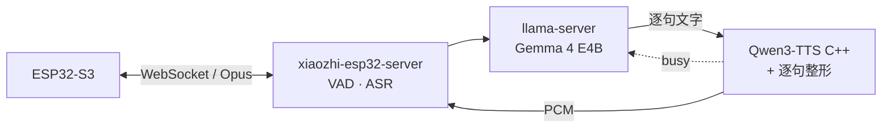
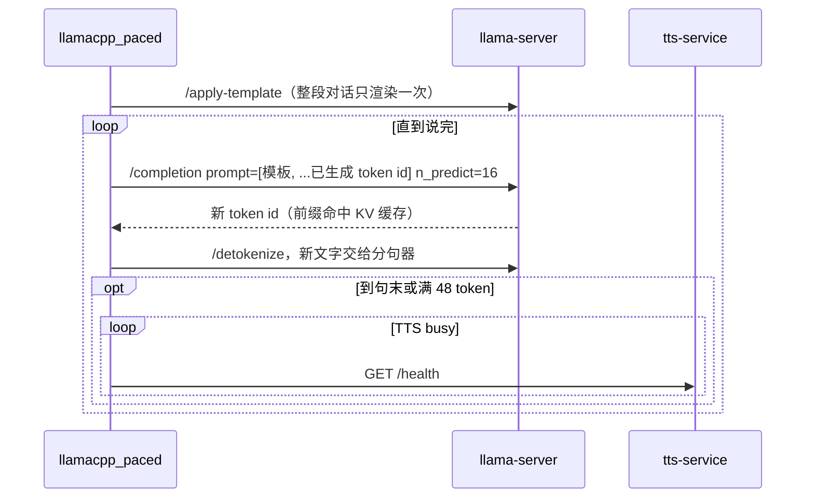

# gpu-duet

**本地 LLM 和声音克隆 TTS，在同一块 8 GB 显卡上轮流跑。**

*Local LLM + zero-shot voice-cloning TTS taking turns on one 8 GB GPU — offline, no stutter, your own voice.*

[效果](#效果) · [Benchmark](#benchmark) · [做法](#做法) · [实现细节](#实现细节) · [快速开始](#快速开始) · [接到别的管线](#接到别的管线) · [29 条踩坑](docs/pitfalls.md)

- **不依赖云端**：ASR、LLM、TTS 全在本机，断网可用。
- **8 GB 显存放得下**：LLM 约 2.9 GB + TTS 约 3.9 GB，GPU 合计约 7.3 GB。
- **不卡顿**：LLM 和 TTS 轮流用 GPU，50 秒级的长回答供音无断档。
- **声音自备**：零样本克隆，3～10 秒参考音即可。

终端用的是 [xiaozhi-esp32](https://github.com/78/xiaozhi-esp32)，但 GPU 轮流、原生 TTS、逐句整形都和它无关，可以接到任何逐句调用 TTS 的语音管线上。

## 效果

<picture>
  <source media="(prefers-color-scheme: dark)" srcset="docs/img/before-after-dark.svg">
  
</picture>

RTX 4060 Laptop 8 GB · 16 GB RAM · Windows 11。首声和断音来自下面的 benchmark（中位数），其余各项条件见 [pitfalls](docs/pitfalls.md)。端到端首声（经过 xiaozhi 和设备）：文字输入 1.0～1.8 s；语音输入（说完算起，含 VAD + ASR）2.0～2.9 s。LLM 解码 63～66 tok/s，TTS RTF 约 0.6。

## Benchmark

把「GPU 协调」和「缩短句子」拆开测，每格 6 次。同一个问题和种子在协调前后生成的文字逐字相同（12/12 对），差别只来自调度。

<picture>
  <source media="(prefers-color-scheme: dark)" srcset="docs/img/bench-dark.svg">
  
</picture>

| 情况 | 句长中位数 | 首声 s | 断音合计 s | 有断音 |
|---|---|---|---|---|
| 无调度 | 40 字 | 3.20（2.89～3.53） | 2.27（1.39～5.12） | 6/6 |
| 仅缩短句子（+0.9 s 停顿） | 13.5 字 | 2.62（2.06～2.68） | 0.48（0～1.55） | 4/6 |
| 仅 GPU 协调 | 40 字 | 1.83（1.49～1.92） | 0 | 0/6 |
| 缩短句子 + GPU 协调 | 13.5 字 | 1.42（1.29～1.64） | 0 | 0/6 |

缩短句子能减少断音，但只有 GPU 协调能稳定压到 0。方法、原始数据和复现命令：[bench/](bench/README.md)。

## 做法



### 1. LLM 和 TTS 轮流用 GPU

<picture>
  <source media="(prefers-color-scheme: dark)" srcset="docs/img/timeline-dark.svg">
  
</picture>

TTS 逐帧解码，是大量很小的同步 kernel，LLM 占一点时间片它就跟不上。给 LLM 限速（20、14 tok/s）无效，调 WDDM 调度优先级也无效。两者合计只需约 75% 的 GPU，所以改成串行：LLM 写完一句就停，等 TTS 不再 `busy` 再续写。

停下再续写，不能丢掉上下文，也不能重算前缀：



- **按 token id 续写，不按文字续写。** chat 接口的 assistant 预填会被模板去掉末尾空白，文字重新切词也会漂移；带 token id 续写和一次性生成逐 token 一致。
- **前缀不变，KV 缓存一直命中。** 每次只算新增的 16 个 token。
- **结束 token 不进文本。** `stop_type == "eos"` 时最后一个 token 会被还原成 `<turn|>` 之类的文字，先去掉。
- **半个字符先扣住。** 多字节字符被切在两块之间时，等下一块补全再输出。
- **探测失败不阻塞。** `/health` 超时按空闲处理，回答照常往下走。

实现：[`llamacpp_paced.py`](server/core/providers/llm/llamacpp_paced/llamacpp_paced.py)（130 行）· 对照：[`turn_taking_sim.py`](tools/turn_taking_sim.py)

### 2. TTS 换成 C++ 原生引擎

<picture>
  <source media="(prefers-color-scheme: dark)" srcset="docs/img/vram-dark.svg">
  
</picture>

在 [qwen3-tts.cpp](https://github.com/Danmoreng/qwen3-tts.cpp) 上加了一个补丁（[`native-tts/`](native-tts/)）：

| 改动 | 收益 |
|---|---|
| Talker 的 Q/K/V 只保留融合后的一份 | GPU −488 MiB |
| 文本 embedding 表留在 CPU，只在 CPU 上查表 | GPU −594 MiB |
| 上面这张表改为只读内存映射，不预读、不复制 | RAM −594 MiB |
| C ABI 桥接库 + 流式回调 | Python 用 ctypes 直接调用，边合成边吐 PCM |
| 启动时比对 C 和 Python 两侧的结构体大小 | 版本对不上直接报错，不会读错内存 |

测过的配置下，PCM 与关闭这些开关时逐字节相同。显存超出 8 GB 时 Windows 驱动不报错，会把一部分挪到共享内存，解码悄悄变慢（[踩坑 #12](docs/pitfalls.md)）。

### 3. 逐句整形

逐句合成的音频直接拼起来，在小喇叭上会出问题（[`leveler.py`](tts-service/leveler.py)）：

| 听到的 | 原因 | 处理 |
|---|---|---|
| 一句大一句小（差 5～7 dB） | 每句响度由模型随机决定 | 用开头 0.6 s 定一个增益，整句不变 |
| 停顿忽长忽短（0.2～1.25 s） | 模型自带的开头静音、句尾长短不一 | 切掉开头静音，句尾统一补齐 |
| 爆音、破音 | 峰值接近满幅，Opus 还会再冲高 | 平滑限幅，峰值 -6 dBFS |
| 开口前「啪」一声 | 设备空闲关功放，开口再上电 | 静默 1.5 s 以上后的第一句前留 0.3 s |
| 句尾有呼吸声 | 模型生成的尾音 | 裁掉最后一段安静、无周期的尾巴（[`tail_gate.py`](tts-service/tail_gate.py)） |

### 4. 唤醒放到服务端（可选）

ESP-SR 不支持的名字（比如日语名），板载 MultiNet 用拼音近似最好 29/60。改成板子常开收音、服务端 ASR 认名字后是 53/60，误唤醒 0/20（[`wakeGate.py`](server/core/handle/wakeGate.py)）。

## 实现细节

| 细节 | 在哪 |
|---|---|
| TTS 同一时间只合成一句：`busy` 是非阻塞锁，并发请求直接回 503，不排队抢 GPU | `tts-service/server.py` |
| 客户端断开就停止合成，不在没人听的句子上花 GPU | `tts-service/server.py` |
| 启动时先合成一句预热，第一句不吃初始化的延迟 | `tts-service/server.py` |
| 可选的提问备注加在最后一条用户消息上，前缀缓存不失效 | `llamacpp_paced.py` |
| `wake_gate.json` 改了就生效，不用重启 | `wakeGate.py` |
| 编译目录超过 60 字符直接报错，绕开 nvcc 的 260 字符路径限制 | `native-tts/build.ps1` |

## 快速开始

**需要：** Windows 10/11 x64、NVIDIA 显卡（实机测过 RTX 40 系）、Python 3.10+、git、llama.cpp 的 [`llama-server`](https://github.com/ggml-org/llama.cpp/releases)（下 Windows CUDA 版）。不用编译，不用装 CUDA Toolkit。下面的命令都在本仓库根目录的 PowerShell 里执行；如果提示「禁止运行脚本」，先执行一次 `Set-ExecutionPolicy -Scope CurrentUser RemoteSigned`。

**1. 下载引擎。** 从 [Releases](https://github.com/korexil/gpu-duet/releases/latest) 下载 zip，解压到比如 `D:\gpu-duet-engine`。再装 Python 依赖，CUDA 运行库也在这一步装好：

```powershell
pip install -r tts-service\requirements.txt nvidia-cuda-runtime-cu12 nvidia-cublas-cu12
```

**2. 下载模型。** 下载约 8.7 GB，占盘约 13 GB（转换完可以删掉 `D:\models\src`）。TTS 会自动转成引擎用的格式，放在 `D:\models\tts`；LLM 放在 `D:\models\llm`。

```powershell
.\native-tts\setup-models.ps1 -Out D:\models -InstallDeps
```

**3. 准备你的声音。** 录一段 3～10 秒的干净语音存成 `my_voice.wav`，把说的内容一字不差写进 `my_voice.txt`：

```powershell
python tts-service\extract_voice.py --library D:\gpu-duet-engine\qwen3_tts_bridge.dll `
    --models D:\models\tts --wav my_voice.wav --text my_voice.txt --out voice\icl-prompt.json
```

**4. 启动 TTS。** 要比 LLM 先启动，否则显存可能被 LLM 先占走（[踩坑 #12](docs/pitfalls.md)）：

```powershell
python tts-service\server.py --library D:\gpu-duet-engine\qwen3_tts_bridge.dll `
    --models D:\models\tts --icl-prompt voice\icl-prompt.json --language zh
```

**5. 另开一个窗口，启动 LLM：**

```powershell
.\scripts\start-llm.ps1 -LlamaServer D:\llama.cpp\llama-server.exe `
    -Model D:\models\llm\gemma-4-E4B-it-q4_0-exact.gguf
```

**6. 验证。** 不接任何设备，让 LLM 讲一段长回答，模拟逐句播放。输出里 `underrun_total_s` 是断音合计，0 就是没卡：

```powershell
python tools\turn_taking_sim.py --mode turns --question "说说你最喜欢的季节，讲长一点。"
```

**7. 接到 xiaozhi（可选）。** 挂载一个文件夹、加两段配置，不用打补丁，见 [server/README.md](server/README.md)。

自己编译引擎见 [native-tts/README.md](native-tts/README.md)。

## 接到别的管线

只在 xiaozhi 上实测过。换框架时要实现的只有两边：

- **TTS**：`POST /stream {"text": "..."}` 返回原始 PCM 流（s16le、24 kHz、单声道）；`GET /health` 返回 `{"busy": bool}`。`tts-service/` 已经是这个接口。
- **LLM 客户端**：照上面的时序图分块续写。`llamacpp_paced.py` 只 import 了 xiaozhi 的 provider 基类和 logger，`turn_taking_sim.py` 就是脱离 xiaozhi 加载它的例子。

## 目录

```
bench/        GPU 协调 × 句子长短 的 benchmark、原始结果
docs/         architecture.md · pitfalls.md · img/（README 图表，make_figures.py 重新生成）
native-tts/   qwen3-tts.cpp 补丁 + Windows CUDA 编译 / 打包脚本 + 模型下载转换脚本
tts-service/  HTTP TTS 服务 + 声音提示提取
scripts/      llama-server 启动参数
server/       xiaozhi-esp32-server 补丁（基于 a6cd755）、新增模块、配置示例
tools/        device_probe · loudness_stats · turn_taking_sim · wake_test · esp32/xiaozhi_assets
```

## 已提交给上游的修复

- [#3411](https://github.com/xinnan-tech/xiaozhi-esp32-server/pull/3411) FunASR 的 JSON 原样进入对话历史
- [#3412](https://github.com/xinnan-tech/xiaozhi-esp32-server/pull/3412) SenseVoice 日语识别结果按词带空格
- [#3413](https://github.com/xinnan-tech/xiaozhi-esp32-server/pull/3413) TTS 分句在引号内切开句子

## 许可

[Apache-2.0](LICENSE)，署名见 [NOTICE](NOTICE)。分发或修改本仓库的代码时，需要保留 NOTICE，并在改动过的文件里注明改过。上游各自适用自己的许可：xiaozhi-esp32-server、qwen3-tts.cpp、ggml（MIT）；Qwen3-TTS、Gemma 4（Apache-2.0）。本仓库不分发模型和 CUDA 运行库。用他人的声音做参考音前，先取得本人同意。
