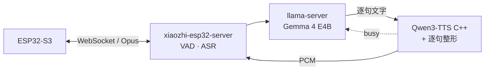

# gpu-duet

**本地 LLM 和声音克隆 TTS，在同一块 8 GB 显卡上轮流跑。**

*Local LLM + zero-shot voice-cloning TTS taking turns on one 8 GB GPU — offline, no stutter, your own voice.*

[效果](#效果) · [做法](#做法) · [快速开始](#快速开始) · [接到别的管线](#接到别的管线) · [24 条踩坑](docs/pitfalls.md)

- **不依赖云端**：ASR、LLM、TTS 全在本机，断网可用。
- **8 GB 显存放得下**：LLM 约 2.9 GB + TTS 约 3.9 GB，GPU 合计约 7.3 GB。
- **不卡顿**：LLM 和 TTS 轮流用 GPU，50 秒级的长回答供音无断档。
- **声音自备**：零样本克隆，3～10 秒参考音即可。

终端用的是 [xiaozhi-esp32](https://github.com/78/xiaozhi-esp32)，但 GPU 轮流、原生 TTS、逐句整形都和它无关，可以接到任何逐句调用 TTS 的语音管线上。

## 效果

RTX 4060 Laptop 8 GB · 16 GB RAM · Windows 11

| 问题 | 之前 | 之后 |
|---|---|---|
| LLM 和 TTS 同卡并发，TTS 跟不上 | 首句 RTF 1.1～1.6，长回答断音 1.47 s | 轮流用 GPU：断音 0，首声 1.6 s → 1.06 s |
| F16 TTS 放不进预算 | PyTorch 版占 8.9 GB 私有内存，频繁换页 | 原生引擎 GPU 3.7～3.9 GB；存储优化再省 GPU 约 1.1 GB、RAM 约 0.6 GB |
| 逐句合成忽大忽小 | 句间差 5～7 dB，偶发爆音 | 句间平均差 3.7 dB，峰值 -6 dBFS，爆音 0 |
| 非中英文名字唤醒 | 板载 MultiNet 最好 29/60 | 服务端识别 53/60，误唤醒 0/20 |

端到端首声：文字输入 1.0～1.8 s；语音输入（说完算起，含 VAD + ASR）2.0～2.9 s。LLM 解码 63～66 tok/s，TTS RTF 约 0.6。各项来自不同测试，条件见 [pitfalls](docs/pitfalls.md)。

## 做法



1. **LLM 和 TTS 轮流用 GPU。** TTS 逐帧解码，大量很小的同步 kernel，LLM 占一点时间片它就跟不上；给 LLM 限速无效。改成 LLM 写完一句就查 TTS 的 `busy`，空闲再续写。
2. **TTS 换成 C++ 原生引擎。** Q/K/V 去重（GPU −488 MiB）、文本 embedding 放 CPU（GPU −594 MiB）并做只读映射（RAM −594 MiB）。测过的配置下 PCM 与未优化时逐字节相同。
3. **逐句整形。** 每句一个增益、切开头静音、统一句尾停顿、平滑限幅、防功放上电 pop。
4. **唤醒放到服务端**（可选）。ESP-SR 不支持的名字，交给服务端 ASR 判断。

结构与资源预算：[docs/architecture.md](docs/architecture.md)

## 快速开始

先不接设备，只验证 GPU 轮流（启动 TTS 和 LLM 后）：

```bash
python tools/turn_taking_sim.py --mode plain --question "Tell me about your day, a bit longer."
python tools/turn_taking_sim.py --mode turns --question "Tell me about your day, a bit longer."
# 输出 first_audio_s / underrun_total_s / worst_gap_s；两次之间等几秒让 GPU 降频
```

完整步骤：

```text
1. 编译 TTS 引擎                native-tts/README.md
2. 用自己的参考音提取声音提示     native-tts/README.md §3
3. 启动 TTS 服务（先于 LLM）      tts-service/README.md
4. 启动 LLM                     scripts/start-llm.ps1
5. 接入 xiaozhi-esp32-server     server/README.md
6. 端到端测量                    tools/device_probe.py · tools/loudness_stats.py
```

## 接到别的管线

只在 xiaozhi 上实测过。换框架时要实现的只有两边：

- **TTS**：`POST /stream {"text": "..."}` 返回原始 PCM 流（s16le、24 kHz、单声道）；`GET /health` 返回 `{"busy": bool}`。`tts-service/` 已经是这个接口。
- **LLM 客户端**：用 llama-server `/completion` 分块续写，prompt 为 `[渲染好的模板, *已生成 token id]`；每到句末或满 48 token 轮询 `/health`，`busy == false` 再继续。参考 `server/core/providers/llm/llamacpp_paced/llamacpp_paced.py`（130 行，只 import 了 xiaozhi 的 provider 基类和 logger）。

## 目录

```
docs/         architecture.md · pitfalls.md
native-tts/   qwen3-tts.cpp 补丁 + Windows CUDA 编译脚本
tts-service/  HTTP TTS 服务
scripts/      llama-server 启动参数
server/       xiaozhi-esp32-server 补丁（基于 a6cd755）、新增模块、配置示例
tools/        device_probe · loudness_stats · turn_taking_sim · wake_test · esp32/xiaozhi_assets
```

## 已提交给上游的修复

- [#3411](https://github.com/xinnan-tech/xiaozhi-esp32-server/pull/3411) FunASR 的 JSON 原样进入对话历史
- [#3412](https://github.com/xinnan-tech/xiaozhi-esp32-server/pull/3412) SenseVoice 日语识别结果按词带空格
- [#3413](https://github.com/xinnan-tech/xiaozhi-esp32-server/pull/3413) TTS 分句在引号内切开句子

## 许可

MIT。上游各自适用自己的许可：xiaozhi-esp32-server（MIT）、qwen3-tts.cpp（MIT）、Qwen3-TTS（Apache-2.0）、Gemma（Gemma Terms of Use）。用他人的声音做参考音前，先取得本人同意。
