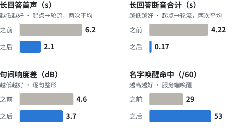
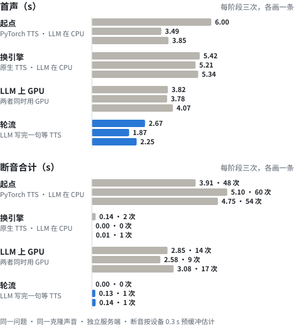
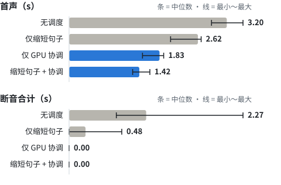

中文 · [English](benchmarks.en.md)

# 实测数据

环境：RTX 4060 Laptop 8 GB、16 GB 内存、Windows 11。下面两组数据口径不同：第一组走完整的独立服务端管线，看从起点到现在每一步的效果；第二组只差调度，用来判断哪个做法真正起作用。

首声 = 问题发出到服务端发出第一帧音频（四阶段：服务端向板子发出第一个 Opus 帧的时刻；对照实验：模拟播放器攒够 0.5 s 开播的时刻）。四阶段的首声包含服务端的尾部扣留：每段最后 `tail_hold_ms`（默认 1200 ms）的音频先扣着，用来修剪段尾静音，所以第一帧要等收到超过 1.2 s 音频（或第一段已经结束）才发出；v0.1.3 起不再扣留（见「v0.1.3」一节）。板子还要缓冲、解码才出声，这一段没有测。断音 = 估算的播放缓冲用空的时长之和（四阶段由服务端按设备 0.3 s 预缓冲估算，对照实验用模拟播放器），都不是在喇叭上直接测的。

<picture>
  <source media="(prefers-color-scheme: dark)" srcset="img/before-after-dark.svg">
  
</picture>

## 四个阶段：同一个问题，首声和断音逐阶段下降

2026-10-16 一次测完四个阶段（00:59–01:37），同一条独立服务端管线、同一把克隆声音、同一个问题「讲一个关于蓝色鹦鹉和月亮的故事，三百字左右。」，每个阶段先问一次热身（不计），再记三次。断音按设备 0.3 s 预缓冲估计（[`standalone/session.py`](../standalone/session.py) 的 `Pacer`）。每次开问前等 10 s 让 GPU 降频。一条记录里只能有一个回答，否则当场作废重测（这次 12 次全部有效）。每个阶段热身的那一次不在记录里。测量顺序是 1、0、2、3（不是按阶段号），没有随机化。提问用文字发给服务端，首声不含 VAD 和 ASR。断音只要播放缓冲空了就计一次，0.01 s 的空档也算，所以「次数」对很短的空档很敏感，看合计更可靠。逐次原始记录（含每句文字，以及 ≥ 0.1 s 的断音出现的时刻；更短的只计入次数和合计）：[bench/results/stages-2026-10-16.txt](../bench/results/stages-2026-10-16.txt)。

<picture>
  <source media="(prefers-color-scheme: dark)" srcset="img/stages-dark.svg">
  
</picture>

| 阶段 | TTS | LLM | 调度 | 首声 s | 断音合计 s（次数） |
|---|---|---|---|---|---|
| 0 起点 | PyTorch 版，GPU | CPU（`-ngl 0`） | 同时跑 | 6.00 · 3.49 · 3.85 | 3.91（48）· 5.10（60）· 4.75（54） |
| 1 换引擎 | 本仓库原生引擎，GPU | CPU | 同时跑 | 5.42 · 5.21 · 5.34 | 0.14（2）· 0（0）· 0.01（1） |
| 2 LLM 上 GPU | 原生引擎，GPU | GPU（`-ngl 99`） | 同时跑（`llm.overlap: true`） | 3.82 · 3.78 · 4.07 | 2.85（14）· 2.58（9）· 3.08（17） |
| 3 轮流 | 原生引擎，GPU | GPU | 每段合成完再生成下一段 | **2.67 · 1.87 · 2.25** | **0（0）· 0.13（1）· 0.14（1）** |

- 第 0 阶段每次断音 48～60 次、合计 3.9～5.1 s，多数不到 0.1 s；≥ 0.1 s 的每次有 8～12 个，最长 0.78 s，都出现在回答的前 35 s 左右（LLM 还在写的时候）；PyTorch 版 TTS 进程私有内存 8.9 GB，16 GB 机器上大半被换到页面文件（[踩坑 #13](pitfalls.md)，10-14 记录）。这一阶段的首声三次之间差得多（3.49～6.00 s），10-14 那两次（6.67、5.81 s）都落在高的一端。
- 第 3 阶段剩下的 0.13～0.14 s 断音出现在第一声之后约 0.2 s（问完后 2.06 s、2.45 s 处），之后整段回答不再断。
- LLM 写完全部文字的时间：第 2 阶段 10.7～13.8 s，第 3 阶段 50.2～59.7 s，回答音频 65～84 s。轮流的代价是 LLM 大部分时间在等 TTS。
- README 里的「之前 / 之后」取第 0 阶段和第 3 阶段三次的平均：首声 (6.00 + 3.49 + 3.85) / 3 = 4.45 ≈ 4.4 s → (2.67 + 1.87 + 2.25) / 3 = 2.26 ≈ 2.3 s；断音 (3.91 + 5.10 + 4.75) / 3 = 4.587 ≈ 4.59 s → (0 + 0.13 + 0.14) / 3 = 0.09 s。
- 每阶段只有三次，用来看量级；可比的统计口径见下一节。
- 2026-10-14 第一次测（每阶段两次）的结果是起点首声 6.67 / 5.81 s、断音 3.68 / 4.75 s，轮流首声 2.09 / 2.12 s、断音 0.13 / 0.20 s；其中换引擎阶段有一条记录混入了两段回答（首声 5.18 s、断音 55.89 s），作废。那次测量脚本没有「一条记录一个回答」的检查，提问原文也没记下来，所以这次整套重测，以这次为准。

## Benchmark：只有 GPU 轮流能把断音压到 0

把「GPU 轮流」和「缩短句子」两个因素拆开的 2×2 对照，每格 6 次，中位数（括号内最小～最大）。同一问题和种子在两种模式下生成的文字逐字相同（12/12 对），差别只来自调度。不经过设备，用 [`tools/turn_taking_sim.py`](../tools/turn_taking_sim.py) 模拟 0.5 s 缓冲的播放器。方法、复现命令和原始数据：[bench/](../bench/README.md)。

<picture>
  <source media="(prefers-color-scheme: dark)" srcset="img/bench-dark.svg">
  
</picture>

| 情况 | 句长中位数 | 首声 s | 断音合计 s | 有断音 | 音频长 s |
|---|---|---|---|---|---|
| 无调度 | 40 字 | 3.20（2.89～3.53） | 2.27（1.39～5.12） | 6/6 | 81（67～118） |
| 仅缩短句子（句间 0.9 s 停顿） | 13.5 字 | 2.62（2.06～2.68） | 0.48（0～1.55） | 4/6 | 45（26～80） |
| 仅 GPU 轮流 | 40 字 | 1.83（1.49～1.92） | 0 | 0/6 | 81（67～118） |
| 缩短句子 + GPU 轮流 | 13.5 字 | 1.42（1.29～1.64） | 0 | 0/6 | 45（26～80） |

只缩短句子时断不断音取决于回答多长，见 [踩坑 #9](pitfalls.md)。

## PCM 跟踪：首声花在哪、断音从哪来

2026-10-16，四阶段里的第 2 阶段（两者同时用 GPU）和第 3 阶段（轮流）各三次，问题、声音同上。服务端在事件流里多记了每句开始合成（`tts_start`）、每块 PCM 到达及其时长（`pcm`）、交给 Pacer 的帧数（`release`，在尾部扣留之后）。原始事件和分析脚本：[bench/results/traces-2026-10-16/](../bench/results/traces-2026-10-16/)、[bench/replay_trace.py](../bench/replay_trace.py)。

| | 轮流 | 同时跑 |
|---|---|---|
| 问完 → 第一句开始合成 | 0.88～1.24 s | 0.72～0.93 s |
| 开始合成 → 第一批 PCM | 1.0～1.2 s | 2.3～2.5 s |
| 第一批 PCM 的长度 | 1.0～1.2 s 音频，一次到齐 | 1.0～1.2 s，一次到齐 |
| 第一批 PCM → 第一帧发出（尾部扣留） | 0.19～0.20 s | 0.46～0.48 s |
| 板子要先攒多少音频才能全程不断（服务端时间线） | 0 / 0.02 / 0.12 s | 1.87 / 3.14 / 3.39 s |
| 实报断音合计 | 0.01 s / 0.13 s / 0 | 3.40 s / 3.15 s / 1.87 s |

- **尾部扣留推迟第一帧。** 第一批 PCM（1.0～1.2 s）不超过 `tail_hold_ms`（1.2 s），所以要等下一块到了才发出第一帧：轮流时多等 0.19～0.20 s，同时跑时 0.46～0.48 s。
- **轮流三次里有一次（duet-2）开头断了 0.13 s，原因就是这个扣留。** 下一块到时只放出超出扣留的部分，一帧（60 ms），板子播完它时再下一块还没到。另两次在那一刻放出了好几帧，断音 0.01 s 和 0。按「PCM 一到就能发」重放第一段，三次都不断，第一帧提前 0.19 s。只重放第一段：之后修剪段尾静音会改变音频长度，这里模拟不了。去掉扣留后，同时跑的三次照样断。
- **同时跑时，TTS 在 LLM 生成期间跟不上。** 第一句的墙钟 RTF（从请求到最后一块 PCM）约 1.3～1.5，轮流时约 0.6（10-18 按到达时刻重测的值；10-16 这里原写的 1.49～1.51 对 0.96～0.98 来自事件循环出队时刻的打点，出队在首帧之后按播放节拍走，早到的块被记晚了；两次测量之间还去掉了扣留、改了停顿方式，这是最可能的解释，不是控制变量的对比，见下一节）。所有断音都在前 13 s 内，也就是 LLM 还在生成或刚写完（10.5～12.3 s）的时候；64～73 s 的回答后面不再断，整段逐句 RTF 中位数和轮流相同（按到达时刻约 0.6；原写的 0.84～0.89 同样是出队时刻的读数）。全程不断所需的等待由这段里最晚的一帧决定。
- **回放的核对。** 用记录的放行时刻、按服务端实际的 5 帧预缓冲重放 Pacer，每次的断音个数都和实报一致，总量差 0.011 s 以内，时刻差几毫秒（有一次 0.090 s 的断音重放成 0.101 s）。改成 7、9 帧结果完全一样，这是算法本身决定的，不是测出来的：预缓冲只限制服务端能提前发几帧，断音估计假设板子收到第一帧就开播。所以这个回放说明不了更大的预缓冲在板子上有没有用，能变的只有「板子等多久再开播」（表中那一行）。这是服务端时间线上的下限：假设板子精确 1 倍速、没有抖动，也不含解码。
- 轮流时 LLM 写完全部文字在 49.5～56.9 s，同时跑时 10.5～12.3 s。

## v0.1.3：去掉尾部扣留之后（2026-10-18）

v0.1.3 不再在服务端扣住每段最后 1.2 s 来修剪静音，而是每句按 `chunk_pause_ms`（0.4 s）向 tts-service 要停顿（请求里的 `pause`），收到的块原样转发；跟踪事件改在工作线程里按到达时刻打点。同一问题、同一声音，轮流和同时跑各三次，原始事件与说明：[bench/results/traces-2026-10-18/](../bench/results/traces-2026-10-18/)。

| | 轮流（10-16 → 10-18） | 同时跑（10-16 → 10-18） |
|---|---|---|
| 第一帧发出 | 2.08～2.66 s → **1.77～1.96 s**（与第一块 PCM 同时） | 3.55～3.77 s → 2.48～4.03 s |
| 断音合计 | 0.01 / 0.13 / 0 → **0 / 0 / 0** | 1.87～3.40 s → 1.59～3.06 s |
| 第一句 RTF（到达时刻） | 0.61～0.62 | 1.33～1.47 |
| 整段逐句 RTF 中位数（到达时刻） | 0.61～0.65 | 0.62～0.65 |

- 轮流时开头那次 0.13 s 的断音没有了，第一帧提前约 0.19 s（表里 10-16 对 10-18 的首帧区间是不同次运行、各 3 次，含 LLM 起步的波动；成对的证据是 10-16 回放里去掉扣留的 0.19 s 和下面 A/B 的 0.2 s）。播出来的东西：同一问题温度 0 经新旧服务端各两次，回答文字相同的那一对，段间停顿、开头和结尾静音的统计相同（句间约 0.45 s，开头 0.37 s，结尾 0.42 s），只有首声早 0.2 s；新服务端的另一次 LLM 给了不同的文字（温度 0 也不保证逐字相同，见踩坑 #25），没法比。只有 1 个问题、1 对有效对比；这一对盲听（1 人）听不出区别；记录和统计脚本在 `bench/results/traces-2026-10-18/ab/`。
- 同时跑时 TTS 只在 LLM 还在生成的前十几秒跟不上（第一句 RTF 1.3～1.5），之后和轮流一样是 0.6；全程不断需要板子先攒 1.6～3.1 s。
- 按钮打断、TTS 出错、TTS 卡死三种情况见 [bench/results/interrupt-2026-10-18/](../bench/results/interrupt-2026-10-18/)：旧回答的事件不会串进新回答，板子按停后收不到旧回答的帧；TTS 报错时回答立刻结束；TTS 卡死由 `tts.read_timeout_s`（10 s）截断。

## 其他指标

| 指标 | 数值 | 来源 |
|---|---|---|
| 显存合计 | 约 7.3 GB / 8 GB（7,448 / 8,188 MiB；TTS 3.9～4.0 GB、LLM 约 2.8 GB、桌面等 0.4～0.6 GB）；不开省显存补丁时推算约 8.3 GB（7,448 + 488 + 594 MiB） | 下方「复现」；[architecture.md](architecture.md#资源预算实测)、[how-it-works.md](how-it-works.md#1-省显存c-原生-tts-引擎--补丁tts-从约-50-gb-降到约-40-gb) |
| TTS 实时率（单独跑） | 约 0.6（自己编译 0.58～0.61，预编译包 0.62～0.70）；LLM 同时解码时第一句 1.1～1.6 | [native-tts/README.md](../native-tts/README.md)、[踩坑 #9](pitfalls.md) |
| LLM 解码 / 首字 | 61～66 tok/s / 0.1～0.2 s（随提示长短） | [踩坑 #4](pitfalls.md)、下方「复现」 |
| 端到端首声，经 xiaozhi-esp32-server | 文字输入 1.0～1.8 s；语音输入（说完算起，含 VAD + ASR）2.0～2.9 s | [architecture.md](architecture.md#延迟用法-c软件链路从发出文字到收到第一个-opus-包) |
| 句间响度差 | 4.6 → 3.7 dB（逐句整形） | [`leveler.py`](../tts-service/leveler.py) |
| 0.25 s 窗口响度起伏（p90-p10） | 5.8～7.5 → 4.7～6.0 dB（standalone 的 AGC，三段固定回答） | `python tools/agc_check.py`（2026-10-14 复现，三段分别 7.2 → 4.9、7.5 → 6.0、5.8 → 4.7 dB） |
| 名字唤醒（日语名，60 条） | 板载 MultiNet 最好 29/60；服务端 SenseVoice 53/60，误唤醒 0/20 | [踩坑 #20](pitfalls.md) |
| GPU 空闲降频 | 空闲 8 s 后 TTS 首块 0.64 s，热态 0.17 s | [踩坑 #11](pitfalls.md) |

### 复现

显存（tts-service、llama-server 都在跑、空闲时，PowerShell）。GB 按任务管理器的口径，1 GB = 1024 MiB：

```powershell
nvidia-smi --query-gpu=memory.used,memory.total --format=csv
(Get-Counter '\GPU Process Memory(*)\Dedicated Usage').CounterSamples |
    Where-Object CookedValue -gt 100MB | Select-Object InstanceName, @{n='MiB'; e={[int]($_.CookedValue / 1MB)}}
```

2026-10-14 实测：合计 7,448 / 8,188 MiB；tts-service 4,027～4,065 MiB（随刚合成的句子长短变化），llama-server 2,899 MiB，其余进程约 480 MiB。

LLM 解码速度和首字：`/completion` 返回的 `timings.predicted_per_second` 和 `timings.prompt_ms`。

```bash
curl -s http://127.0.0.1:18080/completion -H "Content-Type: application/json" \
  -d '{"prompt": "Tell me a long story about autumn.", "n_predict": 200, "cache_prompt": false}'
```

2026-10-14 复现 10 次（生成 48～400 token、提示 36～408 token）：解码 61.0～63.9 tok/s，prompt 36 token 时 57～84 ms、408 token 时 164～177 ms。早先的记录是 63～65 tok/s（[踩坑 #4](pitfalls.md)）和 66 tok/s（[踩坑 #12](pitfalls.md) 显存溢出之前），文档里统一写作 61～66 tok/s。

图由 [`img/make_figures.py`](img/make_figures.py) 生成。
