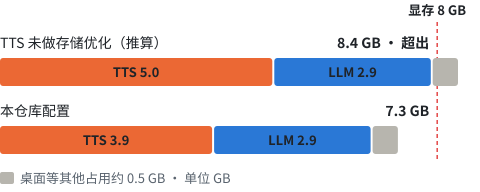

[中文](how-it-works.md) · English

# How it works

Three techniques, each solving one problem: not enough VRAM, GPU contention, and incoherent audio from sentence-by-sentence synthesis.

## 1. Saving VRAM: native C++ TTS engine + patches, TTS from about 5.0 GB down to about 4.0 GB

<picture>
  <source media="(prefers-color-scheme: dark)" srcset="img/vram-dark.svg">
  
</picture>

The TTS uses [qwen3-tts.cpp](https://github.com/Danmoreng/qwen3-tts.cpp) @ `16bb5af` plus this repo's patch ([`native-tts/qwen3-tts-cpp-16bb5af.patch`](../native-tts/qwen3-tts-cpp-16bb5af.patch)). `tts-service/server.py` turns on the switches below by default; for the seeds, texts and parameters tested, the PCM is byte-for-byte identical to the output with the storage switches off.

| Change | Switch | Gain |
|---|---|---|
| Keep only the fused copy of the Talker Q/K/V | `QWEN3_TTS_QKV_DEDUP=1` | about 488 MiB less GPU memory |
| Keep the text embedding table on the CPU and look it up there | `QWEN3_TTS_TEXT_EMBD_CPU=1` | about 594 MiB less GPU memory |
| Make that table a read-only memory map (by row range, no prefetch, no copy) | `QWEN3_TTS_TEXT_EMBD_MMAP=1` | about 594 MiB less RSS |
| Decoder batches on demand | `QWEN3_TTS_LAZY_BATCH_DECODER=1` | — |
| After the end token, feed 3 frames of codec silence so the vocoder renders the tail (repeating the last frame doubles the ending audibly) | `QWEN3_TTS_TAIL_PAD_FRAMES=3` (0 turns it off) | Sentence endings are no longer cut off (about 0.24 s) (in the prebuilt package from v0.1.3 on) |
| C ABI bridge library `qwen3_tts_bridge` + streaming callback | CMake `-DQWEN3_TTS_BUILD_C_BRIDGE=ON` | Called directly from Python via ctypes; PCM comes out while synthesis is still running |
| ABI self-check: struct sizes, each field's offset and type code | — | A mismatch between the bindings and the library version is reported at load time |
| Exported functions catch C++ exceptions at the C boundary | — | An engine error returns an error message instead of taking down the Python process |
| Model, voice prompt and reference audio paths opened as UTF-8 (`_wfopen` / `CreateFileW`) | — | Chinese and Japanese directory names work |

Switch value rules, ABI check details and build instructions: [native-tts/README.md](../native-tts/README.md) (Chinese).

On the LLM side: Gemma 4 E4B runs with all layers on the GPU, and the per-layer embedding table stays in RAM and is read on demand (`--lazy-mode on`; otherwise available memory on a 16 GB machine drops below 0.5 GB during loading). **Start the TTS before the LLM**, or the LLM may claim VRAM first and the TTS gets moved to shared memory ([pitfall #12](pitfalls.en.md)). Parameters: [`scripts/start-llm.ps1`](../scripts/start-llm.ps1).

## 2. Taking turns on the GPU: the LLM pauses after every sentence and continues once the TTS has finished synthesizing it

<picture>
  <source media="(prefers-color-scheme: dark)" srcset="img/timeline-dark.svg">
  
</picture>

While the LLM is decoding, the TTS's first-sentence real-time factor rises to 1.1–1.6, slower than playback (suspected to be because the TTS decodes frame by frame, as a large number of very small synchronizing kernels; not verified with a profiler). Throttling the LLM (20, 14 tok/s) and changing the WDDM scheduling priority both had no effect ([pitfall #9](pitfalls.en.md)), so the two are serialized: the LLM stops at the end of a sentence and continues once the TTS has finished synthesizing it.

The order of interactions between `llamacpp_paced` and the two services during one answer:

1. `POST /apply-template`: render the template once for the whole conversation.
2. Loop until the end or `max_tokens`:
   1. `POST /completion` with `prompt = [rendered template, ...already generated token ids]` and `n_predict = 16`. The prefix is unchanged, so the KV cache hits and only the 16 new tokens are computed.
   2. `POST /detokenize`; hand the new text to the sentence splitter.
   3. At a sentence end, or after 48 tokens: `GET /health`, waiting up to 0.4 s to see whether the TTS has picked up this sentence (`busy` becomes true or `started` goes up by one); once it has, poll every 20 ms and continue only when `busy` is false (waiting at most 30 s per sentence).

Details:

- Continuation uses token ids, not text: the chat endpoint's assistant prefill has its trailing whitespace stripped by the template, and re-tokenizing text also drifts ([pitfall #10](pitfalls.en.md)).
- When `stop_type == "eos"`, the last token gets restored as text like `<turn|>`; strip it first.
- When a multi-byte character is split between two chunks, hold it back and emit it once the next chunk completes it.
- The `/health` `started` counter lets a sentence that is synthesized between two polls still be seen; a failed probe counts as idle and doesn't block the answer.
- In standalone, the LLM output is pulled segment by segment inside the synthesis thread (the next segment of text is pulled only after the previous one has been synthesized), which is already serial, so `llm.turn_taking` is off by default; the `/health` handshake is used in the xiaozhi-esp32-server setup.

Implementation: [`llamacpp_paced.py`](../server/core/providers/llm/llamacpp_paced/llamacpp_paced.py) (163 lines).

| Parameter | Default | Description |
|---|---|---|
| `chunk_tokens` | 16 | Tokens per `/completion` continuation |
| `turn_tokens` | 48 | If no sentence end is hit, hand over to the TTS after writing this many tokens |
| `handoff_wait` | 0.4 s | Longest wait for the TTS to pick up a sentence after handing it over |
| `max_tokens` | provider 400, standalone 1500 | Upper limit for one answer |
| `question_rest_note` | — | Optional. When the previous answer ended with a question, appended to the last user message without breaking the prefix cache ([pitfall #7](pitfalls.en.md)) |

Tool calling is not supported: `response_with_functions` ignores `functions` and only writes a log line.

### Using it in your own program

If you don't connect a board (mode A) or you use another voice framework, there are only two sides to wire up: the tts-service HTTP API (see [tts-service/README.md](../tts-service/README.md) (Chinese)), and chunked continuation against llama-server following the sequence above.

`llamacpp_paced.py` imports only two names from xiaozhi, the provider base class and the logger, so it loads directly once you substitute stand-ins: [`standalone/brain.py`](../standalone/brain.py) and [`tools/turn_taking_sim.py`](../tools/turn_taking_sim.py) both use it this way. The handshake relies on polling: after handing over a sentence it waits up to `handoff_wait` seconds to see whether the TTS has picked it up; if your sentence splitter often holds text for longer, raise it, or the two will overlap again.

## 3. Per-sentence shaping: even out loudness, pauses and peaks

What goes wrong on a small speaker when sentence-by-sentence audio is simply concatenated, and how each is handled:

| What you hear | Cause | Handling | Where |
|---|---|---|---|
| One sentence loud, the next quiet (5–7 dB apart) | The model picks each sentence's loudness at random | Set one gain from the voiced part of the first 0.6 s (target -18 dBFS, at most +9 dB) and keep it for the whole sentence | `tts-service/leveler.py` |
| Pauses vary in length (0.2–1.25 s) | The model puts 0.4–0.7 s of leading silence on each sentence, and the end varies | Cut the leading silence; pad the end to `--sentence-pause` (default 0.9 s), and 0.5 s for short replies of up to `--clause-chars` (default 6) characters | `leveler.py` |
| Pops and distortion | Peaks near full scale, and Opus overshoots further | Smooth limiter in 1 ms blocks down to -6 dBFS, then a hard limit at -3 dBFS | `leveler.py` |
| A "pop" before it speaks | The device turns its amplifier off when idle | 0.3 s of silence before the first sentence after 1.5 s or more of silence | `leveler.py` |
| Breath at the end of a sentence | Tail audio generated by the model | Trim the last quiet, non-periodic stretch (holding back at most about 0.8 s) | `tts-service/tail_gate.py` |
| Sentence ending cut off | The model stops while the last syllable is still sounding | The engine feeds 3 extra frames (see section 1) | Patch |
| Loud at the start of a sentence and quiet at the end | Gain is set from the start only | Slow AGC: 60 dB/s down, 6 dB/s up, target -20 dBFS, at most +8 / -10 dB | `standalone/agc.py` (standalone only) |
| Pauses between segments too long | 0.9 s was padded onto the end of every segment | Ask tts-service for `chunk_pause_ms` (400 ms) of silence per sentence (the request's `pause`); before v0.1.3 the server held back the last 1.2 s to trim it, which delayed the first frame by 0.19 s and sometimes left a 0.13 s gap at the start. Previously: trim each segment's trailing silence to `chunk_pause_ms` (400 ms) before sending frames | `standalone/session.py` (standalone only) |

Loudness between sentences is set only from the RMS of each sentence's first 0.6 s (measured loudness spread between sentences 4.6 → 3.7 dB); this is not a loudness standard. Where each one came from: [pitfalls #14–#17](pitfalls.en.md) and [standalone-tuning.md](standalone-tuning.md) (Chinese).
